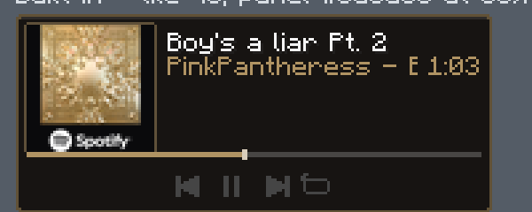
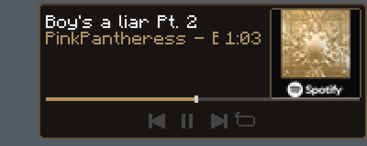

# MineTunes


A client-side Fabric mod for Minecraft **1.21.11** that puts a now-playing card on your HUD and
lets you drive whatever Windows is already playing — Spotify, YouTube, a podcast, a video —
without leaving the game.

It reads the **Windows SMTC media session**, so it is not tied to any one player: whatever shows
up in Windows' own volume flyout is what the card shows.




The two pictures above are the same card, drawn by the same code, parked on opposite halves of the
screen. A card in a right-hand corner turns to face that corner: the sleeve takes the outer edge,
the words take the other side, and the clock comes in against the artwork.

## What you get

- A now-playing card: album sleeve, title, artist and album, elapsed time, progress bar, four
  transport buttons.
- Play / pause, previous, next, seek, shuffle and repeat, through the same session the OS media
  keys use.
- Album art pulled from the session, with the panel's accent colour picked off the cover.
- Text that does not fit slides instead of being cut off.
- Drag the card anywhere on screen. It mirrors when parked past the middle.
- The four buttons answer clicks while another screen is open — inventory, chat, Mod Menu — so you
  can skip a track without closing what you were looking at. With nothing open there is no mouse
  target, so use the keys or `/music`. (See [known limits](#known-limits) on this one.)
- Six keybinds in their own **MineTunes** category, rebindable from the mod's own settings screen.
- **Decks**: community-made looks in a JSON file, no code and no rebuild.

## Requirements

| | |
| --- | --- |
| Minecraft | 1.21.11 |
| Loader | Fabric Loader 0.19.2 or newer, plus Fabric API |
| Java | 21 or newer |
| OS | Windows 10 / 11 (SMTC is a Windows feature) |

Client-side only. Nothing is sent to the server and other players see nothing.

## Install

Drop `minetunes-1.0.0.jar` into your `mods` folder, replacing any older Music Deck jar. The internal
ID remains `musicdeck` so existing keybinds, settings, and community decks keep working.
On first launch the mod writes its settings file
and three example decks; there is nothing else to set up. Start playing something in Windows and the
card appears.

If you use a launcher with per-profile game directories (TLauncher, Prism, MultiMC), the jar goes in
that **profile's** `mods` folder, not the global one.

## Controls

| Key | What it does |
| --- | --- |
| `P` | Play / pause |
| `N` | Next track |
| `O` | Previous track |
| `K` | Toggle the panel |
| `U` | Open the move screen (drag the card, `Enter` to drop) |
| `=` | Open MineTunes settings |

All six are rebindable, in vanilla's Controls screen under the **MineTunes** category or in the
mod's own settings.

## Commands

`/music` and `/minetunes` do the same thing, and every verb tab-completes.

```
/music status                      what the session says right now
/music play | pause | toggle
/music next | prev
/music seek <seconds>
/music shuffle [on|off]            repeat shuffle if the player hides the verb
/music repeat [none|track|playlist]
/music hud [x y]                   show, hide, or place the card
/music move                        the drag screen
/music style [smooth|pixel]        how the album art is scaled
/music theme [auto|green|white]    panel colour
/music deck [name]                 which deck to draw with
/music settings                    the settings screen
/music restart                     re-launch the media helper
```

## Files the mod writes

| Path | What it is |
| --- | --- |
| `<game dir>/musicdeck.properties` | position, deck, theme, art style, visibility |
| `<game dir>/config/musicdeck/decks/` | your decks. Three examples are seeded on first run |
| `<game dir>/spotify.properties` | legacy settings, read only while `musicdeck.properties` is missing |

## Decks

A deck is a JSON file in `config/musicdeck/decks/`. The mod re-reads the folder when you open the
deck picker, so a new file shows up without a restart. Every value is clamped and unknown keys are
ignored, so a deck written for a newer version still draws.

```json
{
  "name": "Big Sleeve",
  "readme": "Artwork above the words, 64px tile.",
  "layout": "stack",
  "tile": 64,
  "panel": "#0a0a0c",
  "opacity": 0.78,
  "accent": "#1db954",
  "detail": true,
  "time": true,
  "progress": true,
  "buttons": true,
  "border": true
}
```

| Key | Default | Range | Meaning |
| --- | --- | --- | --- |
| `name` | file name | | what the picker shows |
| `layout` | `row` | `row`, `stack` | sleeve beside the words, or above them |
| `tile` | `48` | 0–64 | artwork size in pixels; `0` drops it |
| `pad` | `4` | 2–10 | gap between the panel edge and its contents |
| `gap` | `5` | 2–12 | gap between the sleeve and the text column |
| `minWidth` / `maxWidth` | `44` / `118` | 20–260 | how wide the text column may get |
| `panel` | `#0a0a0c` | hex | panel colour, `#RRGGBB` or `#AARRGGBB` |
| `opacity` | `0.85` | 0.15–1 | panel alpha |
| `accent` | from cover | hex | progress bar and clock colour |
| `detail` / `time` / `progress` / `buttons` / `border` | `true` | | turn each row of the card off |

## Building

```
./gradlew build
```

The jar lands in `build/libs/`. The first run needs network access: Fabric Loom downloads Minecraft
and its mappings. After that `--offline` works.

### Checking it without launching the game

The card's geometry lives in `HudLayout`, which draws through an interface rather than touching the
game, so the whole layout is testable with a bare JDK:

```
javac -encoding UTF-8 -d build-gate tools/CheckHud.java \
  src/client/java/com/musicdeck/client/{HudCanvas,HudLayout,NowPlaying,Palette,JsonLine,DeckSkin,DeckLibrary}.java
java -cp build-gate CheckHud
```

494 checks cover the geometry, the slide timing, the deck parser's clamps, the config file, the
screens and the language keys.

The mutation suite plants deliberate defects to check that the tests reject broken code:

```
bash tools/mutate-hud.sh
```

187 plants, and the last line must read `surviving plants: 0`. Read the `SKIP` and `NOT-APPLIED`
lines too — a plant that never compiled, or an anchor that no longer exists in the source, is lost
coverage rather than a passing test.

To see the card rather than measure it, `tools/HudPreview.java` renders every deck, both parked
sides, a mid-slide frame and a hovered button into one PNG. It wants a square album image to draw as
the sleeve — `tools/gen-art.ps1` writes one out of whatever Windows is playing, and any other square
PNG works too:

```
javac -encoding UTF-8 -d build-preview tools/HudPreview.java \
  src/client/java/com/musicdeck/client/{HudCanvas,HudLayout,NowPlaying,Palette,JsonLine,DeckSkin,DeckLibrary}.java
java -cp build-preview HudPreview build-art/art.png build-art/hud-preview.png
```

`tools/inspect-jar.ps1` reads the built jar back and checks the manifest, the entrypoints, the icon
bytes and the bundled helper are all what the source says.

## How it reaches Windows

`src/main/resources/musicdeck/smtc-bridge.ps1` is bundled inside the jar and unpacked to
`<game dir>/musicdeck/` at startup. It polls the SMTC session in a separate process, streams JSON
state to the mod through stdout, saves the thumbnail as `art.png`, and takes commands from files
in the `commands/` folder. The mod itself never talks to the network, never registers a URL handler,
and does not need admin rights.

## Known limits

These are ceilings in the SMTC contract, not bugs in the mod:

- **No volume verb.** The session exposes play, pause, skip and position, so the mod can set the
  player's position but not the system volume.
- **Shuffle and repeat are often hidden.** Many players report neither verb as supported, so the
  repeat button on the card can do nothing and `/music shuffle` can come back with no effect. The
  mod sends the request and reports what the session said; it cannot make a player obey.
- **The session follows whoever took it last.** Starting a video in Chrome can steal it from the
  music app, and the card changes with it.
- **Position is extrapolated.** Some players only report a new position when the track changes, so
  the bar estimates between reports and can drift until the next one.
- **The thumbnail arrives after the title.** Expect the artwork to lag the text by up to a second on
  a track change.
- **Click-through is the least proven part of the mod.** The card is drawn on the HUD, so its
  buttons only receive a click when another screen is open, and that path is wired through Fabric's
  `ScreenMouseEvents` rather than covered by the checks above. If it misbehaves on your setup, the
  keybinds and `/music` go through the same verbs and do not depend on it.

## License

MIT — see [LICENSE](LICENSE).

"MineTunes" is this mod's own name. Spotify is a trademark of Spotify AB; the only thing this mod
shares with it is that both can read what you are playing.
