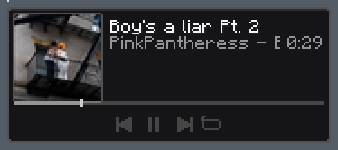
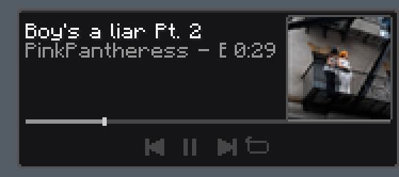
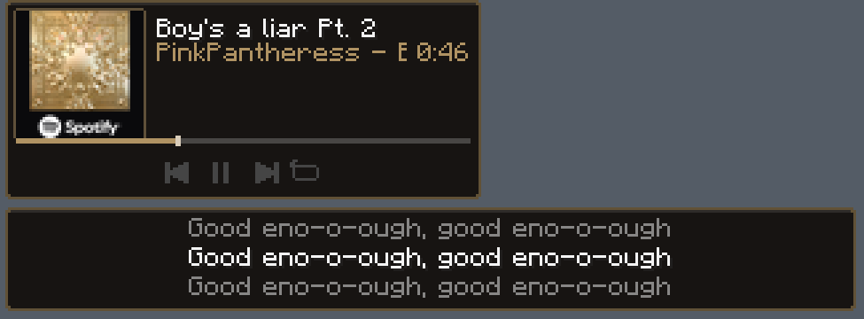
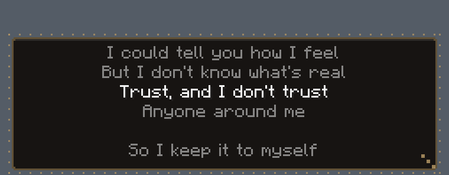

# MineTunes


A client-side Fabric mod for Minecraft **1.21.11 and the 26.x line** that puts a now-playing card on
your HUD and lets you drive whatever Windows is already playing — Spotify, YouTube, a podcast, a
video — without leaving the game.

It reads the **Windows SMTC media session**, so it is not tied to any one player: whatever shows
up in Windows' own volume flyout is what the card shows.




The two pictures above are the same card, drawn by the same code, parked on opposite halves of the
screen. A card in a right-hand corner turns to face that corner: the sleeve takes the outer edge,
the words take the other side, and the clock comes in against the artwork.

## What you get

- A now-playing card: album sleeve, title, artist and album, elapsed time, progress bar, four
  transport buttons.
- Play / pause, previous, next, seek, shuffle and repeat, through the same session the OS media
  keys use.
- Album art pulled from the session, with the panel's accent colour picked off the cover.
- Text that does not fit slides instead of being cut off.
- Drag the card anywhere on screen. It mirrors when parked past the middle.
- The four buttons answer clicks while another screen is open — inventory, chat, Mod Menu — so you
  can skip a track without closing what you were looking at. With nothing open there is no mouse
  target, so use the keys or `/music`. (See [known limits](#known-limits) on this one.)
- Six keybinds in their own **MineTunes** category, rebindable from the mod's own settings screen.
- **Decks**: community-made looks in a JSON file, no code and no rebuild.
- **Lyrics**: the line being sung, in a panel of its own. It starts under the card but is a box
  like the card: drag it anywhere, stretch it, and give it its own look — band on or off, its own
  opacity, one to nine rows. A `.lrc` you save is always used first; a track with no file is looked
  up once on [lrclib.net](https://lrclib.net) and the answer is kept in the folder, so the next play
  is a local read. `/music lyrics off` stops the lookup.

## Requirements

| | |
| --- | --- |
| Minecraft | 1.21.11, 26.1.2, 26.2 or 26.3 |
| Loader | Fabric Loader 0.19.2 or newer (0.19.3 on 26.x), plus Fabric API |
| Java | 21 or newer on 1.21.11; **25** on 26.x |
| OS | Windows 10 / 11 (SMTC is a Windows feature) |
| Network | optional: only the lyrics lookup uses it, and `/music lyrics off` turns that off |

One jar per Minecraft version, matched by file name: `minetunes-1.1.0.jar` is the 1.21.11 build,
and the 26.x builds end in `+26.1.2`, `+26.2` and `+26.3`. A 26.x jar will not load on 1.21.11 and
vice versa — that is the point of the suffix.

Client-side only. Nothing is sent to the Minecraft server and other players see nothing. The only
network traffic is the lyrics lookup above; with it off, or with a local file present, the mod opens
no connection at all.

## Install

Drop the jar whose name matches your Minecraft version into your `mods` folder, replacing any older
Music Deck jar. The internal ID remains `musicdeck`, so existing keybinds, settings and community
decks keep working across versions. On first launch the mod writes its settings file and three
example decks; there is nothing else to set up. Start playing something in Windows and the card
appears.

If you use a launcher with per-profile game directories (TLauncher, Prism, MultiMC), the jar goes in
that **profile's** `mods` folder, not the global one.

## Controls

| Key | What it does |
| --- | --- |
| `P` | Play / pause |
| `N` | Next track |
| `O` | Previous track |
| `K` | Toggle the panel |
| `U` | Open the move screen (drag the card or the words, `Shift`+arrows resize) |
| `=` | Open MineTunes settings |

All six are rebindable, in vanilla's Controls screen under the **MineTunes** category or in the
mod's own settings.

## Commands

`/music` and `/minetunes` do the same thing, and every verb tab-completes.

```
/music status                      what the session says right now
/music play | pause | toggle
/music next | prev
/music seek <seconds>
/music shuffle [on|off]            repeat shuffle if the player hides the verb
/music repeat [none|track|playlist]
/music hud [x y]                   show, hide, or place the card
/music move                        the drag screen
/music style [smooth|pixel]        how the album art is scaled
/music theme [auto|green|white]    panel colour
/music deck [name]                 which deck to draw with
/music lyrics                      whether the playing track has words, and which file answered
/music lyrics on | off             turn the lrclib.net lookup on or off
/music lyrics panel [on|off]       the band behind the words
/music lyrics lines <1-9>          how many rows the panel shows
/music lyrics opacity <auto|%>     band alpha; auto follows the deck
/music lyrics size <w> <h>         the box in GUI pixels, or auto
/music lyrics place <x> <y>        where the box sits, or auto
/music lyrics reset                back to under the card, three rows, the deck's own alpha
/music settings                    the settings screen
/music restart                     re-launch the media helper
```

## Files the mod writes

| Path | What it is |
| --- | --- |
| `<game dir>/musicdeck.properties` | position, deck, theme, art style, visibility, the `onlineLyrics` switch, and the lyric box (`lyricsX/Y/Width/Height/Lines/Panel/Opacity`) |
| `<game dir>/config/musicdeck/decks/` | your decks. Three examples are seeded on first run |
| `<game dir>/config/musicdeck/lyrics/` | your `.lrc` files and every lyric the lookup has found. One example is seeded on first run |
| `<game dir>/spotify.properties` | legacy settings, read only while `musicdeck.properties` is missing |

## Decks

A deck is a JSON file in `config/musicdeck/decks/`. The mod re-reads the folder when you open the
deck picker, so a new file shows up without a restart. Every value is clamped and unknown keys are
ignored, so a deck written for a newer version still draws.

```json
{
  "name": "Big Sleeve",
  "readme": "Artwork above the words, 64px tile.",
  "layout": "stack",
  "tile": 64,
  "panel": "#0a0a0c",
  "opacity": 0.78,
  "accent": "#1db954",
  "detail": true,
  "time": true,
  "progress": true,
  "buttons": true,
  "border": true
}
```

| Key | Default | Range | Meaning |
| --- | --- | --- | --- |
| `name` | file name | | what the picker shows |
| `layout` | `row` | `row`, `stack` | sleeve beside the words, or above them |
| `tile` | `48` | 0–64 | artwork size in pixels; `0` drops it |
| `pad` | `4` | 2–10 | gap between the panel edge and its contents |
| `gap` | `5` | 2–12 | gap between the sleeve and the text column |
| `minWidth` / `maxWidth` | `44` / `118` | 20–260 | how wide the text column may get |
| `panel` | `#0a0a0c` | hex | panel colour, `#RRGGBB` or `#AARRGGBB` |
| `opacity` | `0.85` | 0.15–1 | panel alpha |
| `accent` | from cover | hex | progress bar and clock colour |
| `detail` / `time` / `progress` / `buttons` / `border` | `true` | | turn each row of the card off |

## Lyrics

Save a lyrics file in `config/musicdeck/lyrics/` and the card picks it up the moment the track
starts. The panel is never narrower than the card and grows for a long line, three lines tall, under
the card (or above it when the card is parked at the bottom): the line being sung is white and its
neighbours are dimmed, so the eye has somewhere to go. When the card mirrors to the right half of the
screen, the panel mirrors with it.



**Placement.** Left alone the panel follows the card: below it while there is room, above it when
there is not, against the same edge. `U` opens the move screen, where the words are a box of their
own: pick them up and drop them anywhere on the screen, even over the card. The dot at their
bottom-right corner is the resize handle — drag it sideways, downwards or both, and the box keeps
the size you gave it, up to nine rows. `Shift`+arrows resize from the keyboard and plain arrows move
the last box picked. `ESC` puts back everything that was there when the screen opened; Done keeps it.



**Look.** The words wear the card's deck, so a deck that recolours the card recolours theirs. The
**Lyrics...** page in settings — or `/music lyrics panel`, `opacity` and `lines` — overrides that
for the panel alone: the band can be switched off, which leaves shadowed words straight on the
world; its alpha can be set by hand, and that number replaces the deck's instead of scaling it; and
the row count decides how many lines the window shows. Sizes and positions in the settings file are
GUI pixels or `auto`, the same automatic layout a fresh install has, and `/music lyrics reset` goes
back to it.

Spotify draws its own lyrics inside its window and hands no part of them to another program, so
there is nothing to read from the session. The words come from two places, in this order:

1. **A file you save** in the lyrics folder. It always wins, because it is the only way to fix a
   timing the site got wrong, and it needs no network.
2. **lrclib.net**, when there is no file and **online lyrics** is on (the default). The mod sends
   the artist, the title and the track's length — nothing else — over HTTPS, once per track, and
   saves the answer as `Artist - Title.lrc` in the same folder. From then on that song is a local
   read again, with or without a network.

The lookup runs on a background thread and never stalls a frame, so the panel appears a moment after
the track starts. A song with no words, an instrumental, a dead network and a refused connection all
end the same way: no panel, no error box, and no retry loop. `/music lyrics` says whether the
lookup is on and which file answered. `/music lyrics off` turns it off — with it off the mod makes
no request at all — and `/music lyrics on` turns it back on. The answer is also cached in memory for
the track that is playing, so the folder is read once rather than sixty times a second.

**Naming.** The file is matched on the artist and title the card already shows, with punctuation
and case ignored, so `Kavinsky - Nightcall.lrc`, `kavinsky nightcall.lrc` and
`Kavinsky_-_Nightcall.lrc` all find the same song. Try the full `Artist - Title` name first; a
title on its own also works, and a bracketed note is dropped from both sides, because Spotify often
carries something like `Nightcall (From "Drive")` that nobody puts in a file name. `/music lyrics`
tells you which file it picked, or names the file a lookup would save.

**Format.** Standard `.lrc`: one `[mm:ss.xx]` stamp per line, and a line can carry several stamps
if a chorus comes back. A timed line with no words is an instrumental gap and the panel leaves that
row empty. `[offset:±ms]` is honoured wherever it sits in the file, positive meaning the words
appear earlier. `[ti:]`, `[ar:]`, `[al:]` and the like are ignored. Enhanced files that stamp every
word with `<mm:ss.xx>` are read too — the per-word stamps are dropped, because the panel paints
whole lines. UTF-8 and Windows-1252 both read; a file that cannot be parsed shows nothing rather
than an error.

## Building

The repository holds two source trees, one per toolchain. They differ only in the Minecraft API
calls that moved between 1.21.11 and 26.x, so a fix usually has to be made in both.

**1.21.11** — the tree at the repository root:

```
./gradlew build
```

**26.1.2 / 26.2 / 26.3** — one tree in `26x/`, one target at a time:

```
cd 26x
./gradlew build -Pminecraft_version=26.1.2
./gradlew build -Pminecraft_version=26.2
./gradlew build -Pminecraft_version=26.3
```

`minecraft_version` defaults to `26.3`. Since 26.x ships unobfuscated, this tree uses plain Loom with
no mappings and compiles against Java 25. Only the numbers differ per target — Fabric API version,
Mod Menu version, the `minecraft` range in `fabric.mod.json` — plus one small `Platform` shim per
target for the screen API and key-type constant that changed between 26.1.2 and 26.3.

The jar lands in `build/libs/`. The first run needs network access: Fabric Loom downloads Minecraft.
After that `--offline` works.

### Checking it without launching the game

The card's geometry lives in `HudLayout`, which draws through an interface rather than touching the
game, so the whole layout is testable with a bare JDK. Run this from the tree you changed — the
26.x tree has the same command with the same file list:

```
javac -encoding UTF-8 -d build-gate tools/CheckHud.java \
  src/client/java/com/musicdeck/client/{HudCanvas,HudLayout,NowPlaying,Palette,JsonLine,DeckSkin,DeckLibrary,Lyrics,LyricsLibrary,LyricsCache,LyricsFetcher,LyricsLayout}.java
java -cp build-gate CheckHud
```

658 checks on 1.21.11, 667 checks on 26.x — the extra nine are the per-target shim checks. They
cover the geometry, the slide timing, the deck parser's clamps, the lyrics parser and matcher, the
lookup's URL, escaping and file naming, the cache's one-request-per-track rule, the config file, the
screens and the language keys.

The mutation suite plants deliberate defects to check that the tests reject broken code:

```
bash tools/mutate-hud.sh
```

288 plants on 1.21.11, 297 on 26.x, and the last line must read `surviving plants: 0`. Read the
`SKIP` and `NOT-APPLIED` lines too — a plant that never compiled, or an anchor that no longer exists
in the source, is lost coverage rather than a passing test.

To see the card rather than measure it, `tools/HudPreview.java` renders every deck, both parked
sides, a mid-slide frame, a hovered button and the lyric panel into one PNG. It wants a square album
image to draw as the sleeve — `tools/gen-art.ps1` writes one out of whatever Windows is playing, and
any other square PNG works too:

```
javac -encoding UTF-8 -d build-preview tools/HudPreview.java \
  src/client/java/com/musicdeck/client/{HudCanvas,HudLayout,NowPlaying,Palette,JsonLine,DeckSkin,DeckLibrary,Lyrics,LyricsFetcher,LyricsLayout}.java
java -cp build-preview HudPreview build-art/art.png build-art/hud-preview.png
```

`tools/inspect-jar.ps1` reads the built jar back and checks the manifest, the entrypoints, the icon
bytes and the bundled helper are all what the source says.

## How it reaches Windows

`src/main/resources/musicdeck/smtc-bridge.ps1` is bundled inside the jar and unpacked to
`<game dir>/musicdeck/` at startup. It polls the SMTC session in a separate process, streams JSON
state to the mod through stdout, saves the thumbnail as `art.png`, and takes commands from files
in the `commands/` folder. The mod registers no URL handler and does not need admin rights. Its one
network call is the lyrics lookup above: an HTTPS GET to lrclib.net carrying the artist, the title
and the length, with a User-Agent that says MineTunes. Nothing else leaves the machine, and nothing
leaves it at all while the lookup is off or a local file exists.

## Known limits

These are ceilings in the SMTC contract, not bugs in the mod:

- **No volume verb.** The session exposes play, pause, skip and position, so the mod can set the
  player's position but not the system volume.
- **Shuffle and repeat are often hidden.** Many players report neither verb as supported, so the
  repeat button on the card can do nothing and `/music shuffle` can come back with no effect. The
  mod sends the request and reports what the session said; it cannot make a player obey.
- **The session follows whoever took it last.** Starting a video in Chrome can steal it from the
  music app, and the card changes with it.
- **Position is extrapolated.** Some players only report a new position when the track changes, so
  the bar estimates between reports and can drift until the next one.
- **The thumbnail arrives after the title.** Expect the artwork to lag the text by up to a second on
  a track change.
- **Lyrics can be missing or mistimed.** The media session carries a title, an artist and a
  position, never the words, and Spotify keeps its lyrics inside its own window. A file you save
  always wins; otherwise the panel depends on lrclib.net having the track, on its timing and on the
  network. A local `.lrc` is the fix for any of those, and it needs no connection.
- **Click-through is the least proven part of the mod.** The card is drawn on the HUD, so its
  buttons only receive a click when another screen is open, and that path is wired through Fabric's
  `ScreenMouseEvents` rather than covered by the checks above. If it misbehaves on your setup, the
  keybinds and `/music` go through the same verbs and do not depend on it.

## License

MIT — see [LICENSE](LICENSE).

"MineTunes" is this mod's own name. Spotify is a trademark of Spotify AB; the only thing this mod
shares with it is that both can read what you are playing.
